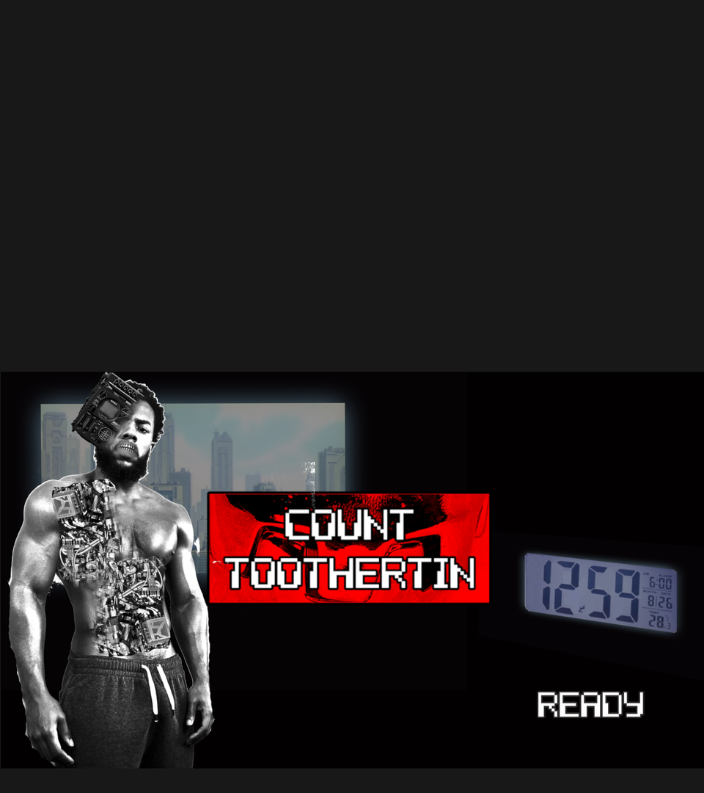
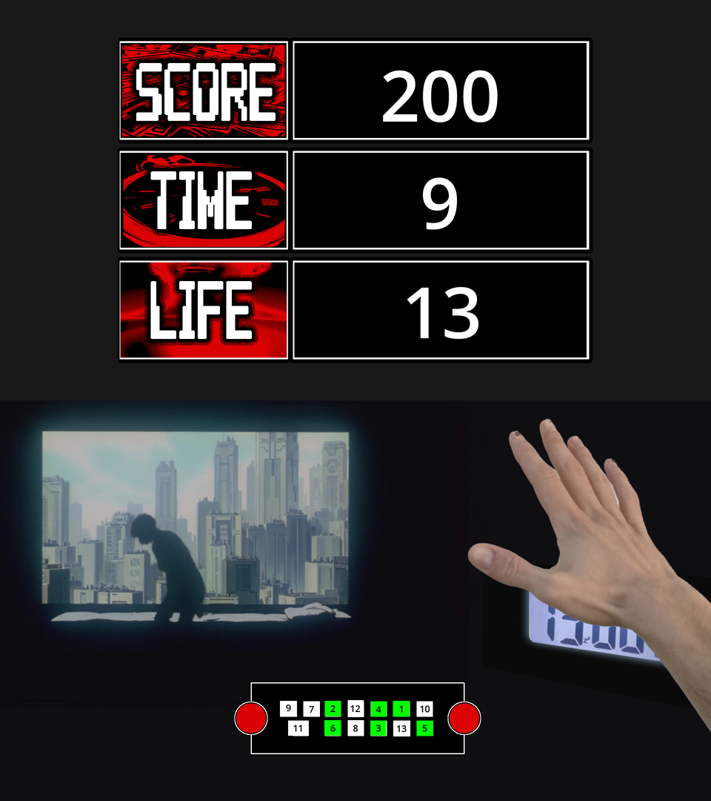
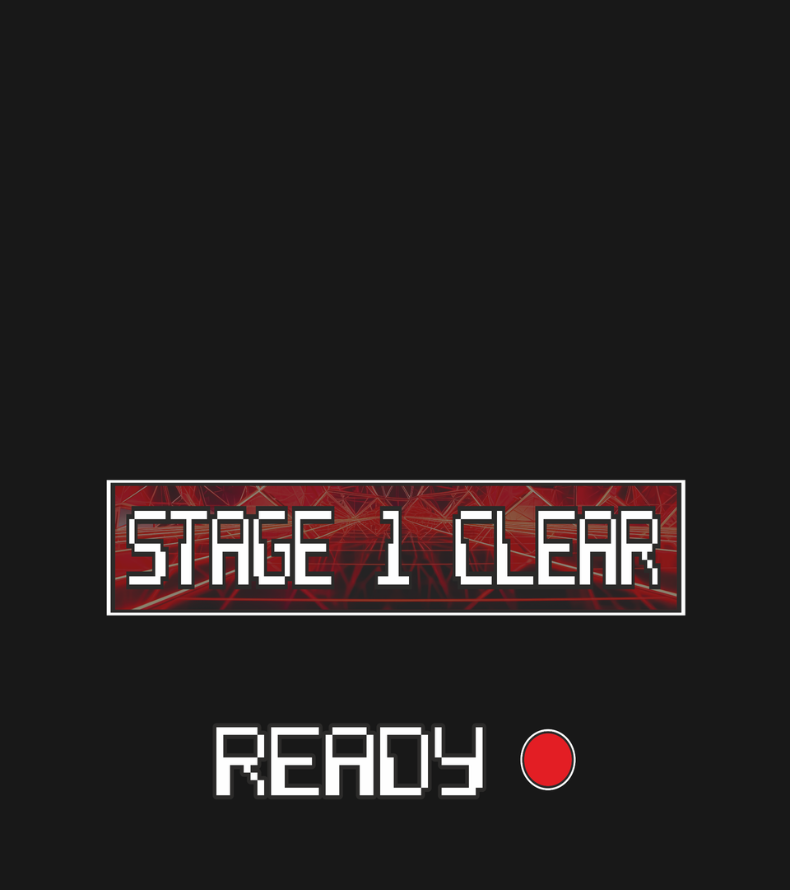
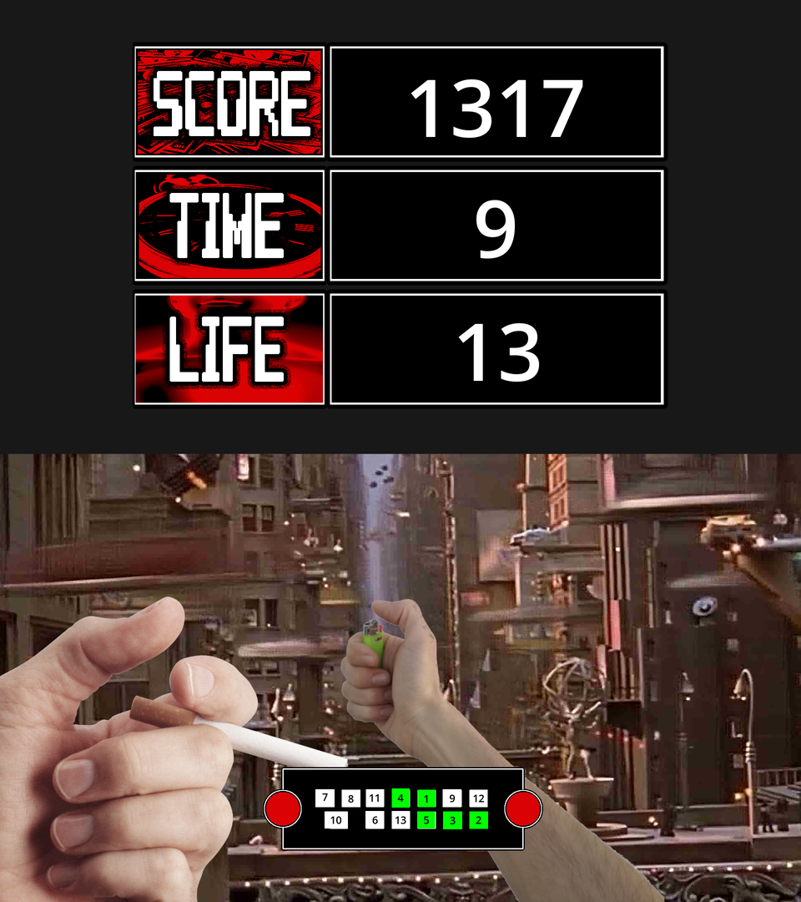
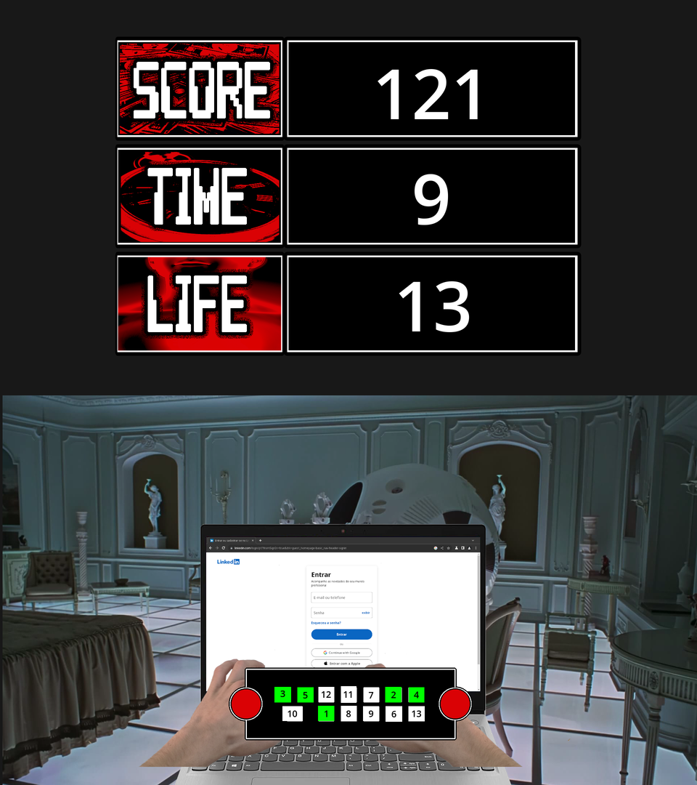
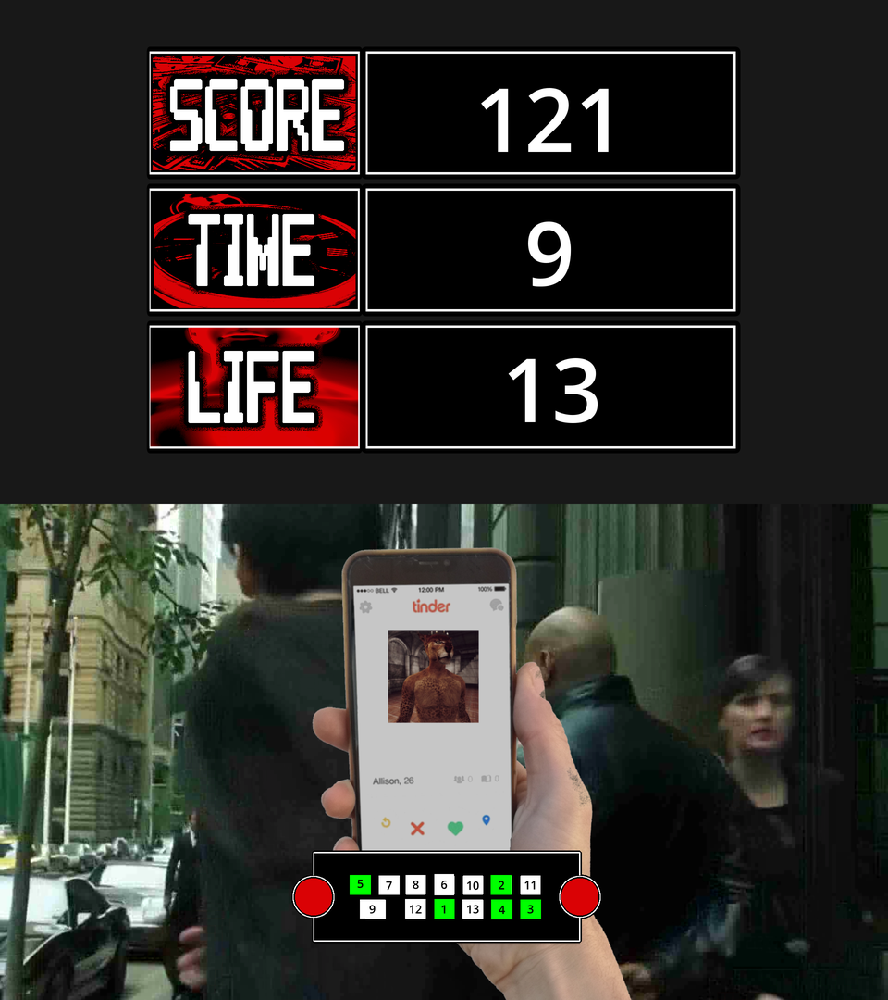
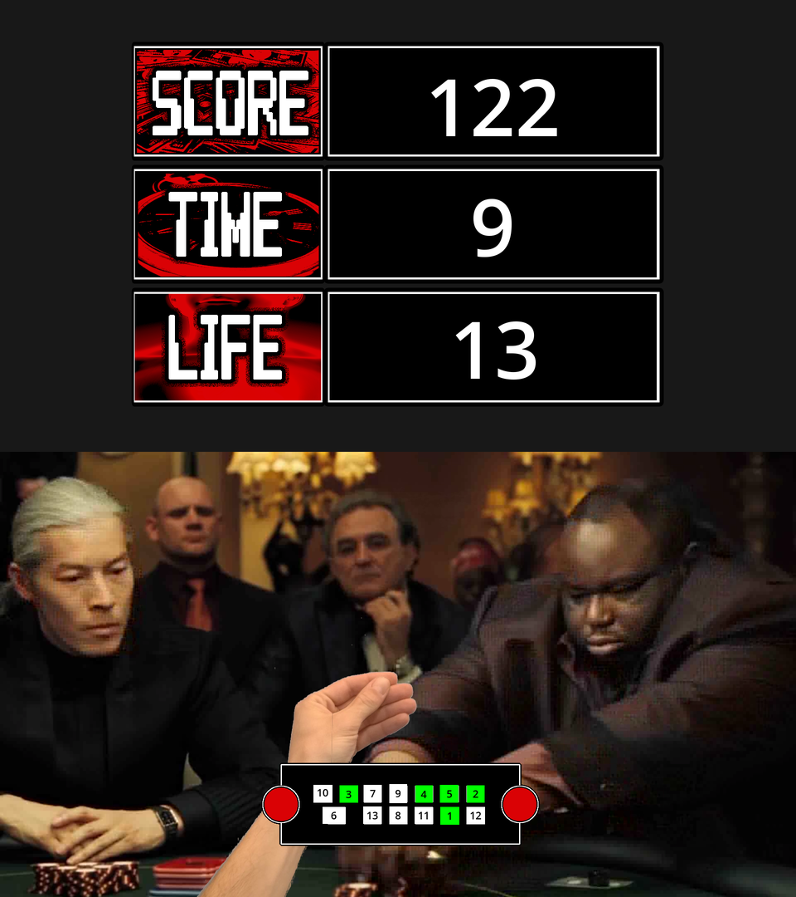
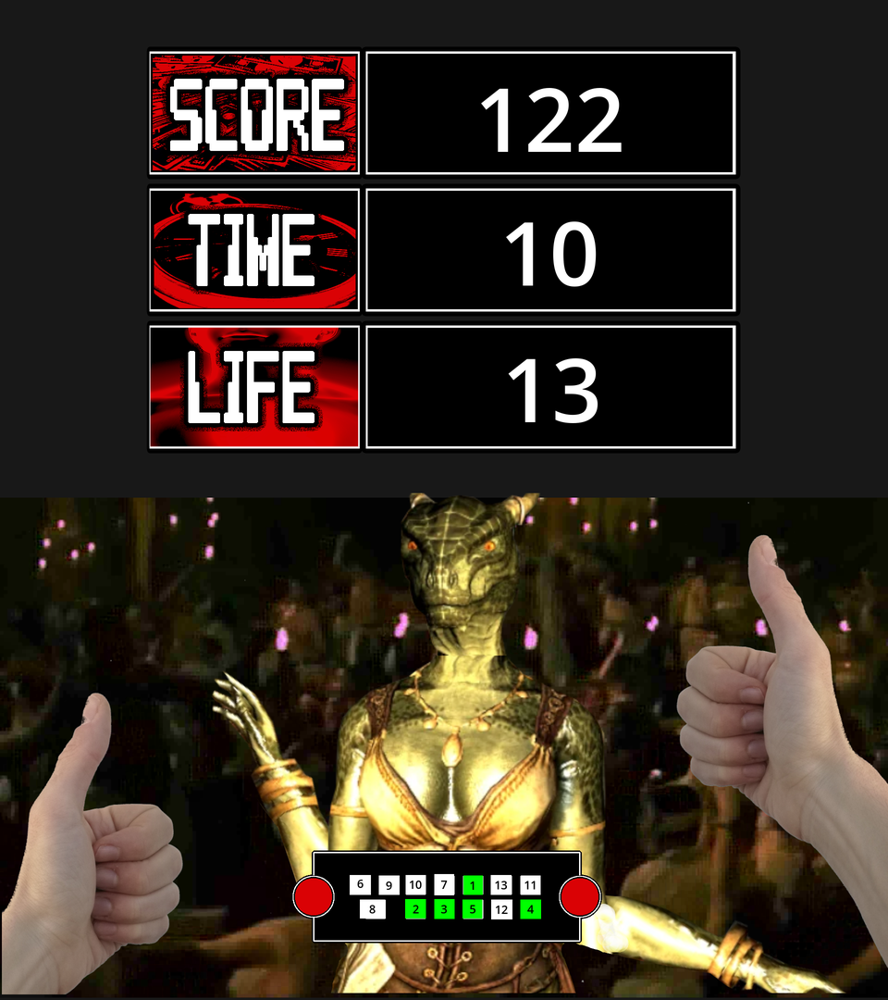
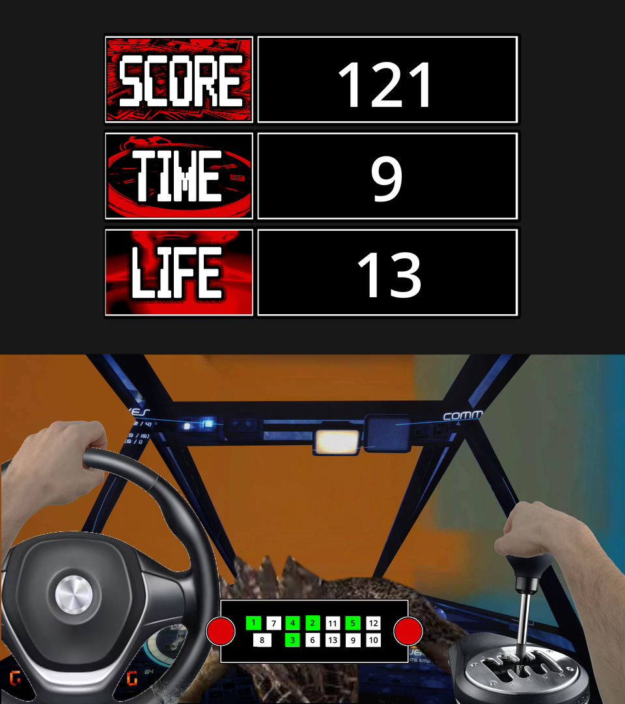
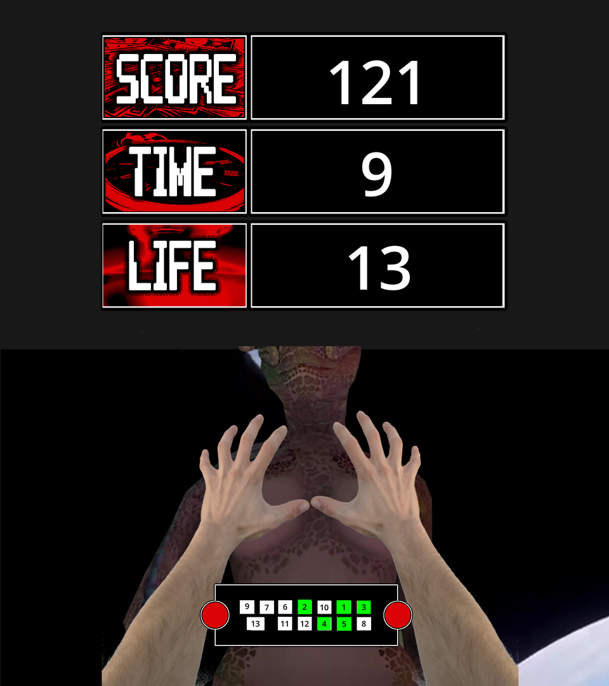

# Invictvs 2023

> A frantic arcade button-masher built in Godot for the Invictvs 2023 game jam. Thirteen numbered buttons, shuffled every level, have to be hit in order, before the clock runs out, over 15 short video-backdropped stages.



## Table of contents

- [Overview](#overview)
- [Screenshots](#screenshots)
- [How to play](#how-to-play)
- [Controls](#controls)
- [Scoring and lives](#scoring-and-lives)
- [Requirements](#requirements)
- [Getting started](#getting-started)
- [Project structure](#project-structure)
- [How it works](#how-it-works)
- [Arcade cabinet support](#arcade-cabinet-support)
- [Known issues](#known-issues)
- [License](#license)

## Overview

Invictvs 2023 is a fast reflex game made for a game jam. Every level shows a short looping film-style video scene, a pair of hands doing something absurd in the foreground ( swiping on a dating app, playing a card game, driving), and a small panel with **13 numbered buttons**. The numbers on the buttons are shuffled on every level, so you have to find 1, then 2, then 3... all the way to 13 as quickly as you can while the timer drains.

Each correct press advances the on-screen hand animation and steadies the hand, a wrong press resets your progress and costs a life, and clearing all 15 levels rolls the credits. The game is designed for a **portrait-oriented arcade cabinet with 2 screens** with physical buttons, but it plays fine on a keyboard or with the mouse.

## Screenshots

These were captured by running the project (Godot 4.5) and playing through it with a script.

| Title screen | Level 1 |
| :---: | :---: |
|  |  |

| Stage clear | Level 2 |
| :---: | :---: |
|  |  |

| Level 4 | Level 6 |
| :---: | :---: |
|  |  |

| Level 8 | Level 10 |
| :---: | :---: |
|  |  |

| Level 13 | Level 15 |
| :---: | :---: |
|  |  |

Green buttons on the panel are the ones you have already pressed in the right order.

## How to play

1. On the title screen, press **Enter** (or click the play button).
2. Look at the panel at the bottom of the screen. Each of the 13 buttons carries a number from 1 to 13, in a random arrangement.
3. Press the buttons **in numerical order**, starting from 1, before the timer reaches zero.
4. Pressing a button that is too far ahead (skipping a number) **resets your progress** for the level and costs one life. Pressing a number you have already passed does nothing.
5. Hit all 13 and the level is cleared. A "Stage N clear" screen appears; press Enter again for the next stage. (Levels 3 and 12 start immediately without the clear screen.)
6. Run out of time or lives and you are sent back to the title screen at level 1.
7. Clear level 15 to watch the credits.

## Controls

| Action | Keyboard | Arcade input name |
| --- | --- | --- |
| Start / continue | `Enter` | `play` |
| Panel button at position 0 | `W` | `0` |
| Panel button at position 1 | `S` | `1` |
| Panel button at position 2 | `E` | `2` |
| Panel button at position 3 | `R` | `3` |
| Panel button at position 4 | `F` | `4` |
| Panel button at position 5 | `T` | `5` |
| Panel button at position 6 | `G` | `6` |
| Panel button at position 7 | `Y` | `7` |
| Panel button at position 8 | `H` | `8` |
| Panel button at position 9 | `U` | `9` |
| Panel button at position 10 | `J` | `10` |
| Panel button at position 11 | `I` | `11` |
| Panel button at position 12 | `K` | `12` |

The keys are laid out to match the physical order of the on-screen panel. The on-screen buttons can also be clicked or tapped (mouse input emulates touch).

## Scoring and lives

- You start each run with **13 lives**.
- Each level has a **26-second timer**, shown on the HUD on a 0-13 scale.
- Every correct press builds a **combo** and fills a hidden **meter**. Faster, unbroken chains fill the meter more, and the points awarded for each press scale with the current meter, so speed and accuracy are both rewarded.
- The meter drains continuously, so hesitating costs you.
- A wrong press resets your combo and progress for that level.

## Requirements

- [Godot](https://godotengine.org/download) **4.1 or newer**. The project was authored in 4.1 and also runs and imports cleanly in 4.5.
- Roughly **525 MB** of disk space: the repository contains the level videos (Ogg Theora), music loops, sound effects and hand/background sprites.
- A GPU with OpenGL / Vulkan support. The project is configured for the mobile renderer.

## Getting started

```bash
git clone https://github.com/FinixGameDev/Invictvs-2023.git
cd Invictvs-2023
```

1. Open Godot and import `project.godot` from the Project Manager.
2. Let the editor import the assets (the first import takes a while because of the audio and video).
3. Press **F5** to run. The main scene is `main.tscn`.

The viewport is 1920x2060 and the window starts at 960x1080 (stretch mode `viewport`, aspect `keep_width`), so the game appears as a tall window.

## Project structure

```
.
├── main.tscn / scripts/main.gd   Title screen, level flow, win/lose handling
├── game_panel.tscn               HUD: 13-button panel, score / time / life display
├── minigame.tscn                 The ordering minigame logic and its timer
├── credits.tscn / credits.gd     End credits, shown after level 15
├── levels/                       Level1.tscn ... Level15.tscn (+ level6.gd)
├── scripts/
│   ├── level.gd                  Base `Level` class: hand animation and sway
│   ├── minigame.gd               Shuffles the solution, handles input, score, lives
│   ├── game_panel.gd             Colours the panel buttons as you progress
│   ├── panel_button.gd           Forwards on-screen clicks as input actions
│   ├── hand_sway.gd              Wobbling hand that steadies as you progress
│   └── tinder.gd                 Swaps the phone card sprite on level 6
├── networking/                   WebSocket client for an arcade cabinet service
├── art/
│   ├── fundos ogg/               Per-level looping background videos (.ogv)
│   ├── imagens finais/           Hands, props and UI sprites
│   ├── Next_level/               "Stage N clear" images and title screen
│   ├── ost mp3/                  Intro + loop music for each level
│   ├── sound fx/                 Sound effects
│   └── snakes/                   Additional audio clips
└── project.godot
```

## How it works

**Level flow.** `main.gd` owns the run state (`level`, `score`). `start_game()` loads `res://levels/Level<N>.tscn`, adds the HUD panel (`game_panel.tscn`) on top, and connects the minigame's `win`, `lost` and `progress` signals. On a win the level counter increments; after level 15 the credits scene plays and the run resets.

**The minigame.** `minigame.gd` builds a random permutation of 1-13 and maps it onto the 13 input actions (`"0"` to `"12"`). Each frame it checks which actions were just pressed: the expected next number advances progress, a number further ahead resets progress and costs a life, and an older number is ignored. It also tracks the combo, the draining meter and the score, and emits `win` when 13 is reached or `lost` when the timer or lives run out.

**Levels.** Every level extends the `Level` class (`scripts/level.gd`). On each `progress` signal it plays the level's hand animation and reduces the hand's sway by 1/13, so the hand visibly settles as you get closer to finishing. Each level scene brings its own looping video, intro and loop music, props and animations.

**Input.** The `play` and `0`-`12` actions are defined in `project.godot`. `panel_button.gd` makes the on-screen buttons emit the same actions, and `reset_buttons.gd` releases them every frame so touch presses behave like clean taps.

## Arcade cabinet support

The `networking/` folder contains a WebSocket client that listens to a cabinet service on `ws://localhost:3333` and translates hardware events (`service`, `pay`, `help`, `bet_*`, `play_*` and `play`) into the game's input actions. `network.tscn` is a standalone scene and these scripts are **not currently attached to `main.tscn`**, so you need to add them to the main scene yourself to use them with cabinet hardware.

## Known issues

- Level 6 logs `Animation not found` errors for hand animations `6-mao-1` and `6-mao_0` in Godot 4.5; the level still plays.
- `networking/network.gd` uses the Godot 3 `WebSocketClient` signal API (`connection_closed`, `data_received`) and will not work as-is in Godot 4. `gestorSockets.gd` with `web_sockets_client.gd` is the Godot 4 version.
- A developer cheat exists in `minigame.gd`: holding the `1`, `3` and `play` inputs together (`S` + `R` + `Enter`) freezes the timer and shows "Cheat" on the HUD.
- `project.godot` still contains leftover Godot 3 / mono settings (`GLES2` driver, `[mono]` assembly name) that Godot 4 ignores.

## License

Released under the [MIT License](LICENSE).
